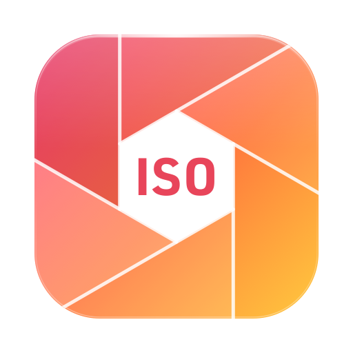
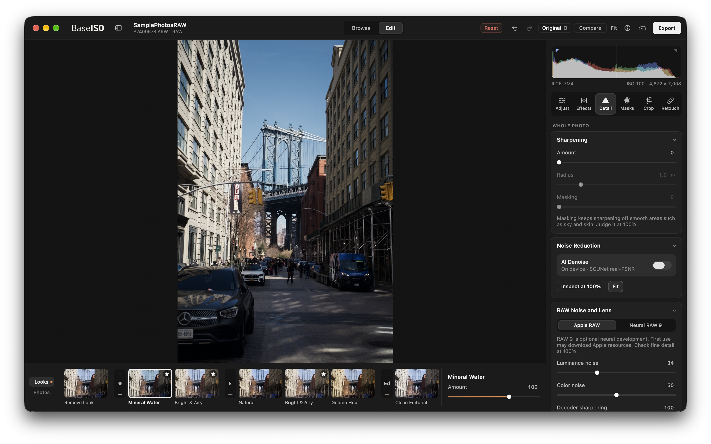

  <picture>
    <source media="(prefers-color-scheme: dark)" srcset="assets/baseiso-icon-dark.png">
    
  </picture>

<h1 align="center">BaseISO</h1>

<strong>A free, privacy-focused RAW and JPEG editor for Mac, with carefully crafted presets and on-device AI noise reduction.</strong>

  <a href="https://github.com/tmanish/base-iso-releases/releases/latest"><strong>Download for Mac</strong></a> ·
  <a href="https://github.com/tmanish/base-iso-releases/releases">Release notes</a> ·
  <a href="https://github.com/tmanish/base-iso-releases/issues">Report a problem</a>

Apple silicon · macOS 27.0 or later

---

- **Free.** No subscription, no account, no preset packs or processing credits to buy.
- **Private.** Noise reduction and smart masks run on your Mac. BaseISO never uploads your photos or uses them to train AI.
- **Carefully crafted presets.** 38 ready-to-publish looks across seven collections, created by a professional photographer and fully adjustable to suit your images.
- **A full editor.** RAW development, curves, color grading, masks, healing, batch edits and export.

Compare with: Lightroom · Photomator

## Install

1. [Download the latest DMG](https://github.com/tmanish/base-iso-releases/releases/latest).
2. Open it and drag **BaseISO** to Applications.
3. Choose **Open Folder** to start editing photos on your Mac or an external drive. No import required.

## Looks

BaseISO's presets—called **looks**—cover portraits, weddings, celebrations, landscapes, travel and everyday photography.

| Collection | Character |
| --- | --- |
| Essentials | Clean, natural starting points |
| Editorial | Polished magazine finishes |
| Cinematic | Graded film-style color |
| Nature & Landscape | Rich skies, foliage and water |
| Film | Film-inspired tone and grain |
| Slide | Punchy slide-film color |
| Black & White | Expressive monochrome |

- Each look is designed to work at **100%**, and the **Amount** slider goes from 0 to 150% when you want it softer or stronger.
- Applying a look leaves your exposure, white balance, RAW noise settings and crop alone.
- Every look stays editable. You can save favorites, make your own presets, and apply one treatment across a whole shoot.

## Editing

**Light and color**
- RAW development with white balance, exposure and RGB curves
- Eight-band color mixer
- Separate grading wheels for Shadows, Midtones and Highlights
- Texture, Clarity and Dehaze

**Local adjustments**
- Brushes, linear and radial gradients
- Luminance and color range masks
- Subject, Background, Sky and Object masks, made on your Mac
- Guided Add/Remove, so you can check and refine a mask before you apply it

**Geometry and retouching**
- Crop, straighten and manual perspective correction
- Heal and Clone

**RAW and noise**
- Apple's standard RAW processing by default, with optional **Neural RAW 9** for supported files
- **AI Denoise** on your Mac, with an adjustable amount to balance noise reduction and fine detail

## Organizing and exporting

- Work straight from your folders and drives. Start browsing large shoots while the remaining photos load.
- Rate, flag and search your photos.
- **Import a Shoot** copies photos from your memory card and verifies each copy, with an option to create a second backup copy at the same time.
- **Bulk Edit** applies a look (or just the settings you pick) to many photos at once.
- Export **JPEG, 16-bit TIFF or 16-bit PNG** with color profiles, resizing and optional watermarks. You can save export presets and follow progress in the export queue.
- Editing is non-destructive. Your originals never change. You also get undo/redo, edit history, snapshots and virtual copies.
- Catalog backups protect your edits. It's still a good idea to keep your own backups of your original photos and watermark files.

## Privacy

BaseISO never uploads your photos, edits or catalog, and never uses your photos to train AI.

- AI Denoise and Subject, Sky and Object masks run on your Mac.
- No account, no analytics and no tracking.
- Your originals stay on your Mac or on whatever storage you choose.

Internet access is used for app updates and downloads of Apple's processing models. Your photos are processed on your Mac. If you sync your photo folders with a cloud service, that service's own privacy terms apply.

## Help and updates

- **Help → BaseISO Help** opens a searchable guide that works offline. It covers editing, masks, RAW processing, export, backups and keyboard shortcuts.
- BaseISO checks for signed updates and lets you decide when to install them. Use **BaseISO → Check for Updates**, or turn automatic checks off.
- To report a problem, [open an issue](https://github.com/tmanish/base-iso-releases/issues) with your BaseISO and macOS versions, your camera and file type, and the steps that cause it. **Help → BaseISO Help → Copy Support Details** copies the version information without any photo paths or catalog contents.

<strong>Known limitations</strong>

- **Camera support.** RAW support comes from macOS and depends on your exact camera and recording mode. Switching between standard RAW and Neural RAW 9 can change how a photo looks.
- **Check AI results.** Look over automatic masks and check noise reduction at 100%. Full-resolution AI Denoise takes longer, and high amounts can soften fine detail.
- **Coming from Lightroom?** Lightroom catalogs and develop presets can't be imported yet.
- **Not available yet:** guided relinking of offline photos, removing a catalog, smart collections, and multi-photo Compare/Survey.
- Perspective correction is manual. Soft Proof previews a color space, not a specific printer or paper.
- Testing on more cameras and scenes, and on M1 Macs with 8 GB of memory, is still in progress. Back up your catalog before you upgrade.

---

This repository hosts BaseISO's downloads and issue tracker. The app's source code is private.
